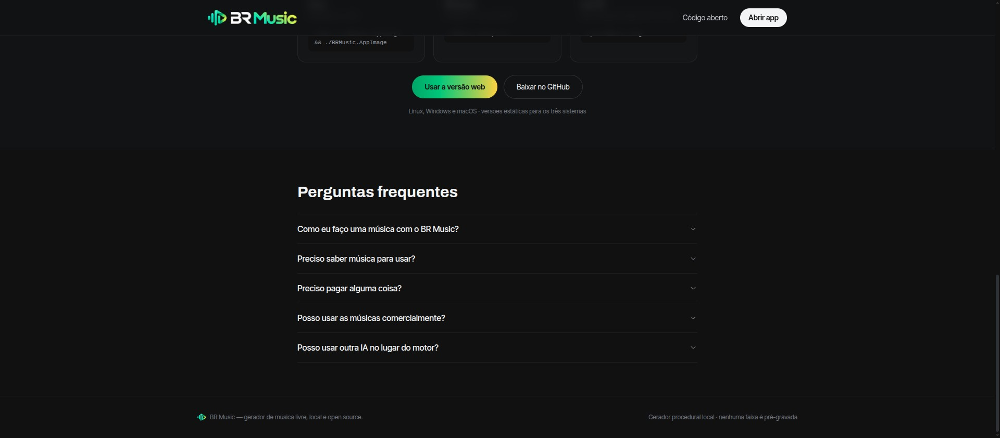
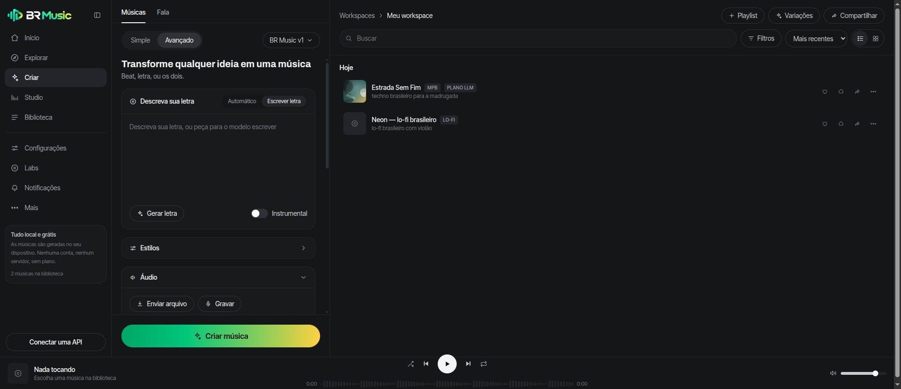
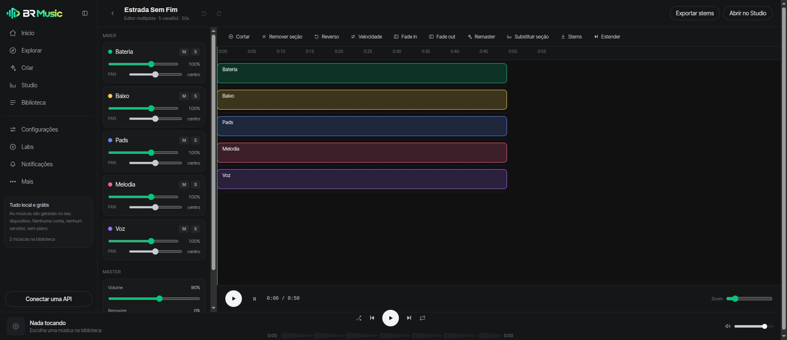
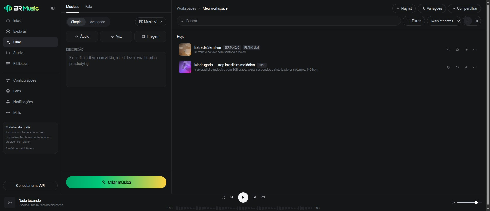
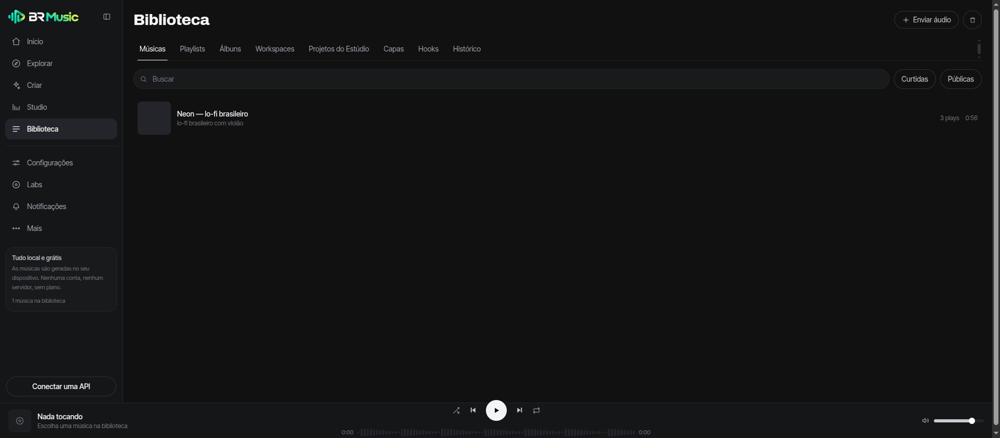
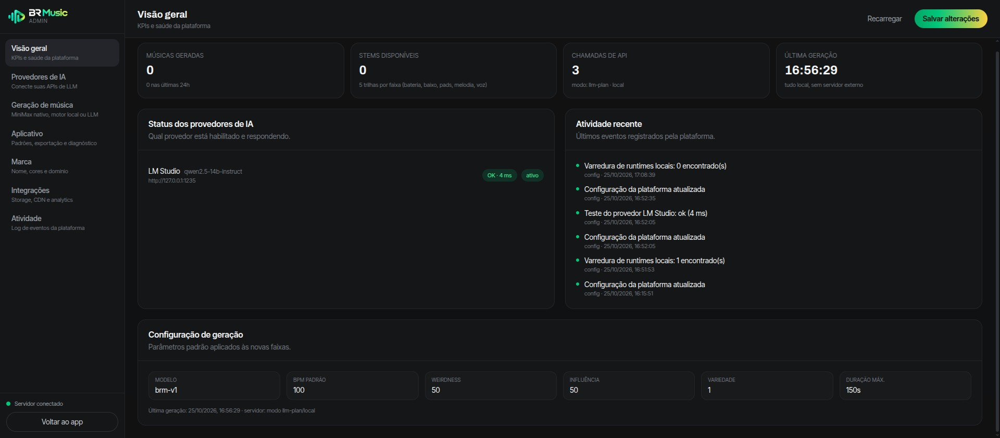
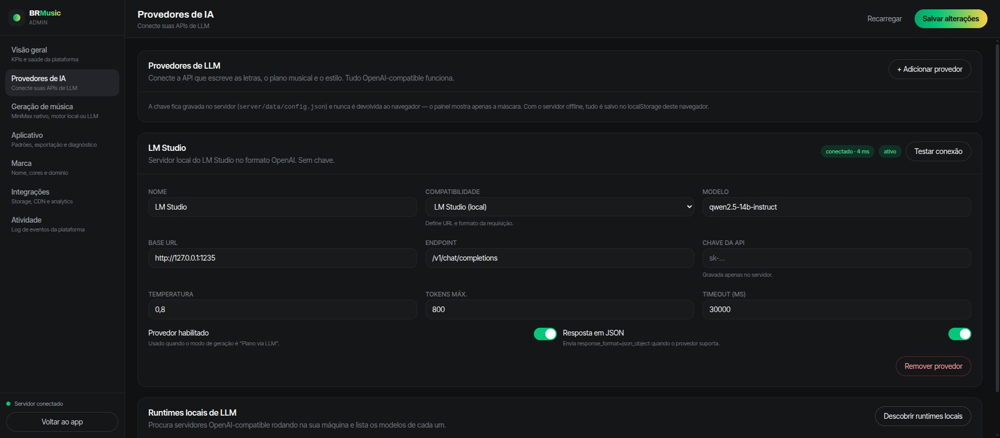
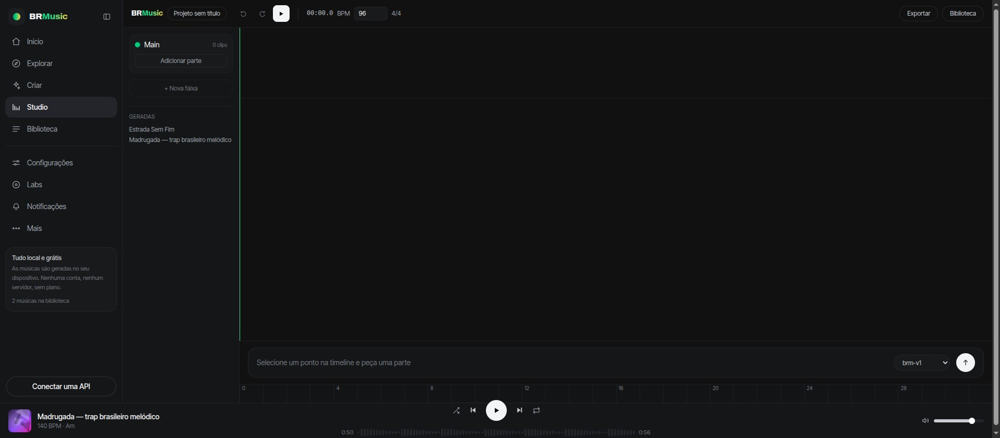
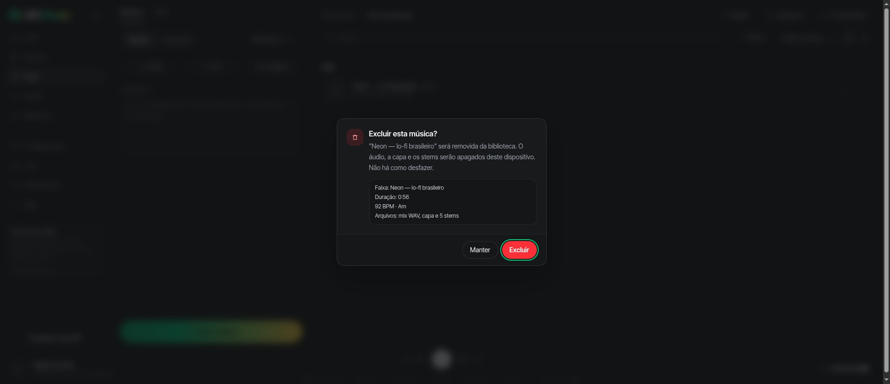

<p align="center">
  
</p>

<p align="center">
  <a href="https://github.com/andersonnarciso/brmusic/releases/tag/v1.0.0"></a>
  
  
</p>

# BR Music

Gerador de músicas com IA **gratuito, local-first e open source**. Crie faixas completas (voz, letra, produção) a partir de uma descrição, com um **painel de configuração** para conectar as suas APIs de LLM e gerar as músicas de verdade.

> MIT, sem conta, sem plano, sem servidor: a síntese roda no seu dispositivo.

**Não existe plano, assinatura, conta nem servidor.** As músicas são sintetizadas no seu dispositivo e ficam offline, no seu navegador ou no app desktop.

---

## Capturas de tela

<p align="center">
  
</p>

| | |
|:--|:--|
|  |  |
| **Criação avançada**: letra com gerador, estilos, áudio e controles criativos | **Editor multipista**: 5 stems, mixer por canal, corte, reverso, velocidade e remaster |
|  |  |
| **Criação**: Simples e Avançado, com a faixa gerada na lista | **Biblioteca**: faixas, playlists, busca, filtros e lixeira |
|  |  |
| **Configuração**: visão geral com KPIs e saúde da plataforma | **Provedores de IA**: APIs OpenAI-compatible, MiniMax e runtimes locais |
|  |  |
| **Studio**: faixas, timeline, transport e prompt na timeline | **Confirmação**: aviso explícito do que será apagado antes de excluir |

---

## O que existe aqui

| Parte | Onde | O que faz |
|---|---|---|
| Site público | `/` | Landing de marketing: hero com gerador, cards de produto, downloads e FAQ |
| App do criador | `#/create` | Criação de música (3 colunas), abas Músicas/Fala, Simples/Avançado, sliders criativos, player |
| Biblioteca | `#/me` | Faixas, playlists, busca, filtros, ordenação, lista/grade |
| Explorar | `#/explore` | Descoberta por estilo e ocasião |
| Studio | `#/studio` | DAW simplificado: faixas, timeline, transport, prompt na timeline |
| **Configurações** | `#/admin` | Provedores de IA, modo de geração, preferências do app, marca, integrações, diagnóstico |
| App desktop | `electron/` | Empacotado para **Linux, Windows e macOS** |
| PWA | `public/sw.js` | Instalável e offline no navegador |

### Modo avançado e editor profissional

O painel de criação tem modo **Avançado** com seções recolhíveis (Letra, Estilos, Áudio), alternador **Automático / Escrever letra**, botão **Gerar letra** (usa o LLM configurado, com gerador local como reserva), interruptor **Instrumental**, upload de áudio, gravação pelo microfone (análise de duração e BPM) e controles criativos.

O **editor multipista** (`#/editor/:id`) abre a faixa com os 5 stems separados e oferece:

| Operação | O que faz |
|---|---|
| Cortar / Remover seção | recorta ou remove o trecho selecionado na régua |
| Reverso | inverte o áudio do canal |
| Velocidade | time-stretch preservando o pitch (WSOLA) |
| Fade in / Fade out | rampas lineares de entrada e saída |
| Remaster | compressor + air shelf + soft clip, sem clipar |
| Substituir seção | regenera o trecho selecionado |
| Get stems | exporta os 5 stems já editados em ZIP |
| Mixer | volume, pan, mute e solo por canal, master com volume, remaster e limitador |

O transporte tem play/stop, posição, zoom e seleção de região. As edições são **não destrutivas**: ficam como operações no canal e podem ser desfeitas.

### Recursos que vão além do original

- **Stems exportáveis**: cada faixa sai separada em **bateria, baixo, pads, melodia e voz** (ZIP), prontas para a sua DAW.
- **Forma de onda real**: o player desenha os picos do áudio sintetizado e aceita clique para buscar.
- **Variações em lote**: gere 4 versões da mesma ideia de uma vez, com seeds diferentes.
- **Remix e extensão**: remixe com outro estilo ou continue a faixa mantendo andamento e tonalidade.
- **Playlists**: organize as faixas localmente.
- **Paleta de comandos**: `⌘K` / `Ctrl+K` com busca e ações; atalhos: `⌘N` (criar), `Espaço` (play/pausa).
- **Capas geradas**: arte de álbum procedural em canvas, a partir da paleta do estilo e do seed da faixa.
- **Conecte qualquer IA**: presets OpenAI-compatible, Anthropic, Gemini, OpenRouter, Groq, **MiniMax** e o **modo nativo da API de Música da MiniMax**, além de 10 runtimes locais (Ollama, LM Studio, llama.cpp, vLLM, LocalAI, KoboldCpp, GPT4All, text-generation-webui, Jan, SGLang) com varredura automática de porta.
- **Editor multipista** com mixer por canal, corte, reverso, velocidade com pitch preservado, fades, remaster e exportação dos stems editados.
- **Hospedagem FTP**: envie as músicas geradas direto para a sua conta de hospedagem tradicional (cPanel, Hostinger, Locaweb), com teste de conexão e envio automático opcional.
- **Lixeira**: exclusão reversível, com restauração ou apagar em definitivo (sempre com confirmação).

**Nenhuma faixa é pré-gravada.** O motor (`src/lib/audio/engine.ts`) sintetiza a música no navegador com Web Audio: bateria, baixo, pad, acordes, lead, camada vocal por formantes, reverb e masterização, em WAV 44,1 kHz estéreo, com canais separados por stem.

---

## Rodando

```bash
cd brmusic
npm install

npm run dev        # dev server (http://127.0.0.1:4321)
npm run build      # build de produção em dist/
npm run server     # servidor com API de configuração + build estático
npm run typecheck  # checagem de tipos
```

O `npm run server` sobe em `http://127.0.0.1:4321` e serve o `dist/` (rode `npm run build` antes). Variáveis úteis:

```bash
PORT=4321
BRMUSIC_ADMIN_TOKEN=seu-token     # exige header x-admin-token nas rotas /api/admin/*
BRMUSIC_DATA_DIR=/caminho/dados   # onde o config.json é gravado
```

### App desktop (Electron)

```bash
npm install --save-dev electron electron-builder
npm run build                 # build do front
npm run desktop:dir           # build não empacotado, para testar
npm run desktop               # instaladores (AppImage/deb, nsis, dmg)
```

Os instaladores para os três sistemas são gerados pelo GitHub Actions (`.github/workflows/release.yml`): tag `v*` dispara builds em Linux, Windows e macOS e publica a release com os arquivos anexados.

No app desktop, o `window.desktop` expõe diálogos de salvamento e gravação direta em disco: o mix e o ZIP de stems são gravados onde você escolher, em vez de baixar.

### PWA

`npm run build` gera um app instalável (manifest + service worker): offline, sem loja de aplicativos.

---

## Conectando suas APIs de IA (painel de configuração)

Abra `#/admin` → **Provedores de IA**. Cada provedor tem: preset de compatibilidade, base URL, endpoint, modelo, **chave de API**, temperatura, tokens máx., timeout, modo JSON, ativar/desativar e **Testar conexão**.

Chaves são gravadas **apenas no servidor** (`server/data/config.json`) e nunca voltam ao navegador, o painel mostra só a máscara. Sem servidor no ar, tudo é salvo no `localStorage` deste navegador.

### Presets disponíveis

| Preset | Base URL | Formato |
|---|---|---|
| **MiniMax** | `https://api.minimax.io/v1` | OpenAI-compatible (`/chat/completions`, `Bearer`) |
| OpenAI | `https://api.openai.com/v1` | OpenAI-compatible |
| Personalizado (OpenAI-compatible) | qualquer URL | qualquer `/chat/completions` (Together, Groq, vLLM, LM Studio, OpenRouter…) |
| Anthropic | `https://api.anthropic.com/v1` | `/messages` com `x-api-key` |
| Google Gemini | `https://generativelanguage.googleapis.com/v1beta` | `/models/{model}:generateContent` |
| OpenRouter | `https://openrouter.ai/api/v1` | OpenAI-compatible |
| Groq | `https://api.groq.com/openai/v1` | OpenAI-compatible |

Modelos MiniMax disponíveis no campo de modelo: `MiniMax-M3.1-Flash-Preview`, `MiniMax-M3`, `MiniMax-M2.7`, `MiniMax-M2.5`, `MiniMax-M2.1`, `MiniMax-M2`.

### Runtimes locais de LLM (todos compatíveis)

O BR Music conversa com **qualquer** servidor OpenAI-compatible rodando na sua máquina, sem chave de API. Há preset pronto para cada um e uma **varredura automática** que encontra o que já está no ar:

| Runtime | Porta padrão | Observação |
|---|---|---|
| Ollama | 11434 | preset próprio (`/api/chat`); também serve `/v1` |
| LM Studio | 1234 | OpenAI-compatible |
| llama.cpp (`llama-server`) | 8080 | OpenAI-compatible |
| vLLM | 8000 | OpenAI-compatible |
| LocalAI | 8080 | Ollama + GPT4All + llama.cpp |
| KoboldCpp | 5001 | com a flag `--api` |
| GPT4All | 4891 | servidor embutido |
| text-generation-webui | 5000 | com a flag `--api` |
| Jan | 1337 | servidor local do Jan |
| SGLang / MiniMax M2 local | 30000 | formato OpenAI |

O botão **“Descobrir runtimes locais”** varre essas nove portas, mostra quais responderam com quais modelos e cadastra o provedor pronto para uso. O mesmo vale para qualquer servidor fora da lista: use o preset “Personalizado (OpenAI-compatible)” com a base URL e o endpoint.

### Três modos de geração de música

Em `#/admin` → **Geração de música**:

1. **Motor local (procedural)**: padrão. Sem servidor, sem custo, funciona offline.
2. **Plano via LLM**: o LLM habilitado escreve o *plano* musical (título, letra com `[Verse]/[Chorus]`, BPM, tonalidade, progressão, seções com energia) em JSON; o motor local executa esse arranjo.
3. **Áudio externo (MiniMax nativo)**: `POST https://api.minimax.io/v1/music_generation`:
   - corpo: `model` (`music-3.0`, `music-2.6`, `music-3.0-free`, `music-cover`…), `prompt`, `lyrics`, `output_format` (`hex`/`url`), `audio_setting` (`sample_rate`, `bitrate`, `format`), `lyrics_optimizer`, `is_instrumental`
   - resposta: `data.audio` em hexadecimal + `base_resp.status_code` (1002 = rate limit, 1004 = autenticação, 1008 = saldo, 1026 = conteúdo bloqueado)
   - o botão **Testar** faz uma geração real curta para validar a chave

O app do criador usa automaticamente o modo configurado; sem servidor no ar, cai para o motor local.

---

## API do servidor

| Rota | Método | Descrição |
|---|---|---|
| `/api/health` | GET | modo de geração, provedor e LLMs habilitados |
| `/api/generate` | POST | `{prompt, lyrics, instrumental, style}` → `{source: "local" \| "llm-plan" \| "minimax", …}` |
| `/api/admin/config` | GET / PUT | configuração completa (segredos mascarados na leitura) |
| `/api/admin/provider/test` | POST | testa um provedor de LLM (`{providerId}`) |
| `/api/admin/music/test` | POST | gera uma faixa real no provedor de áudio |
| `/api/admin/users` · `/api/admin/plans` | GET / PUT | legados, o produto é free e local, sem contas |
| `/api/admin/stats` | GET | KPIs da plataforma |
| `/api/admin/ftp/test` | POST | testa a conexão com a hospedagem FTP |
| `/api/ftp/upload` | POST | envia um arquivo (base64) para o FTP |
| `/api/lyrics` | POST | gera a letra com o LLM habilitado |
| `/api/admin/activity` | GET | eventos registrados (via `config.activity`) |

---

## Estrutura

```
brmusic/
├── src/
│   ├── lib/
│   │   ├── audio/{engine,theory,presets}.ts   # síntese, escalas, estilos
│   │   ├── store.ts                           # estado + player + persistência
│   │   ├── persist.ts                         # localStorage + IndexedDB
│   │   ├── export.ts                          # WAV/ZIP, download ou gravação no desktop
│   │   ├── adminClient.ts                     # client da API de configuração
│   │   └── adminTypes.ts                      # tipos da configuração
│   ├── components/                            # Sidebar, PlayBar, CreatePanel, SongList, Waveform, CommandPalette, Slider, Icons
│   ├── pages/                                 # Landing, Home, Library, Explore, Studio, Simple
│   ├── admin/                                 # AdminApp, Providers, Manage, ui
│   └── App.tsx                                # roteador por hash + atalhos
├── electron/                                  # app desktop (main, preload)
├── server/index.mjs                           # API de configuração + proxy + estáticos
├── public/                                    # manifest PWA, service worker, ícones
├── rea-analysis/                              # evidência bruta do REA
└── REA-RELATORIO.md                           # relatório do reverse engineering
```

### Decisões técnicas

- **Roteamento por hash** (`#/create`) para funcionar em qualquer hospedagem estática sem rewrite.
- **Dois stores independentes** (`appStore` e `playerStore`): o player atualiza 4×/s sem re-renderizar a árvore inteira.
- **Metadados em localStorage, blobs em IndexedDB**: o áudio não estoura a cota de 5 MB e continua disponível após reload (URLs de blob são recriadas no boot).
- **Tailwind v4** com tokens de tema em `src/styles.css`; build ≈ 27 KB de CSS e ≈ 80 KB de JS (gzip).

---

## Limites conhecidos

- Upload de áudio/voz/imagem (remix por arquivo), hooks, álbuns e "Cover Art" são telas/abas, sem backend correspondente. Stems, playlists, variações, remix e extensão **funcionam**.
- A "voz" do motor procedural é uma camada sintética por formantes, não vocals cantados de verdade.
- Sem servidor no ar, o painel de configuração persiste no `localStorage` e o teste de conexão de API não consegue chamar o provedor real.
- Os instaladores de Windows e macOS são compilados no CI (o macOS exige runner macOS); localmente, só o Linux é empacotável.
- A síntese é procedural: não há modelo de áudio treinado por trás. Nada é pré-gravado.
