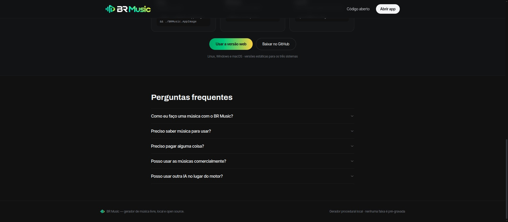
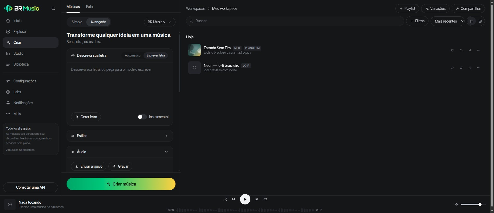
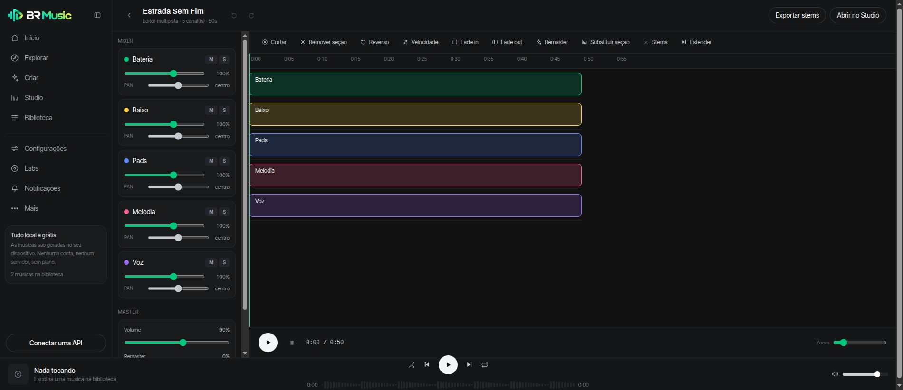
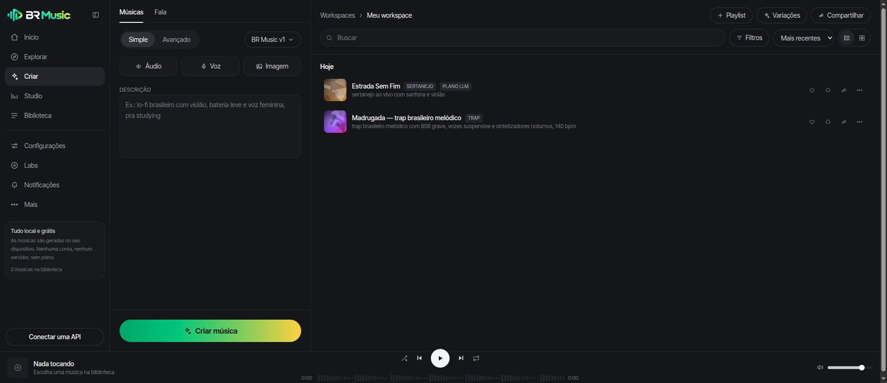
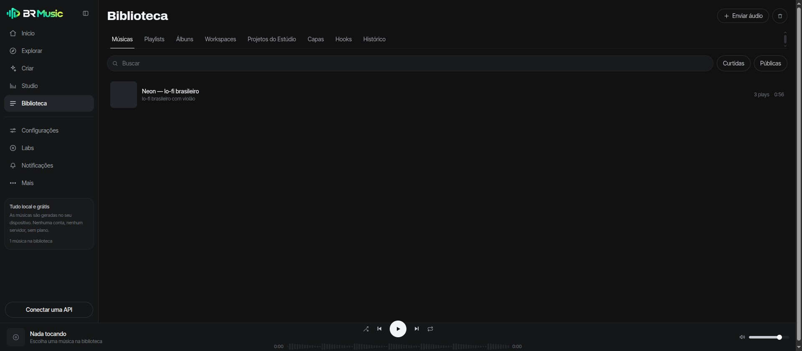
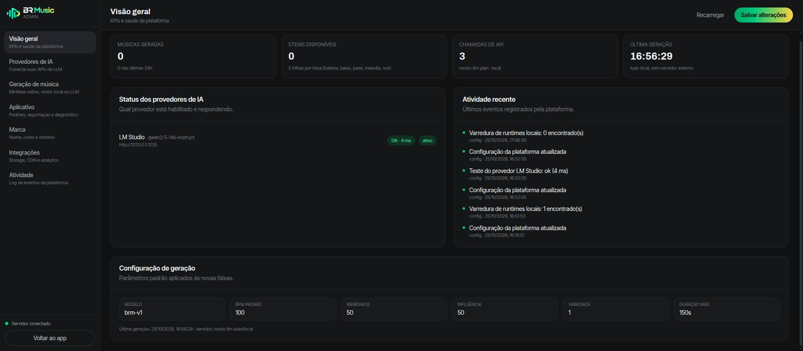
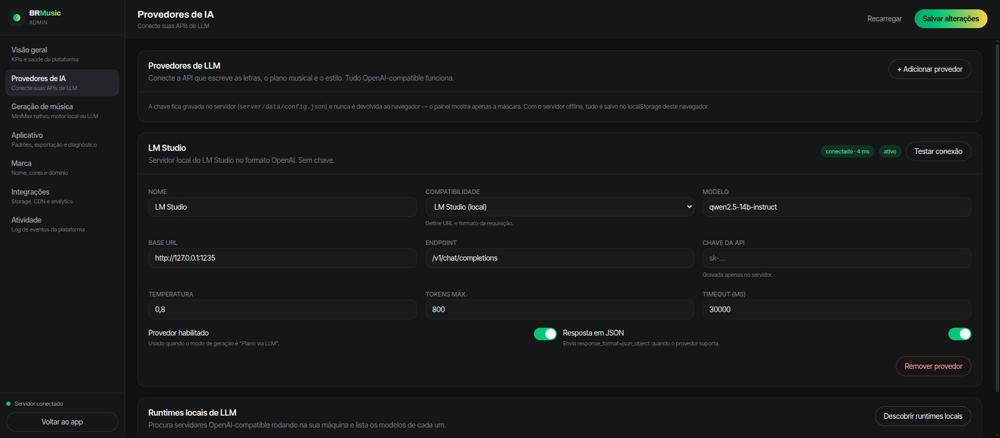
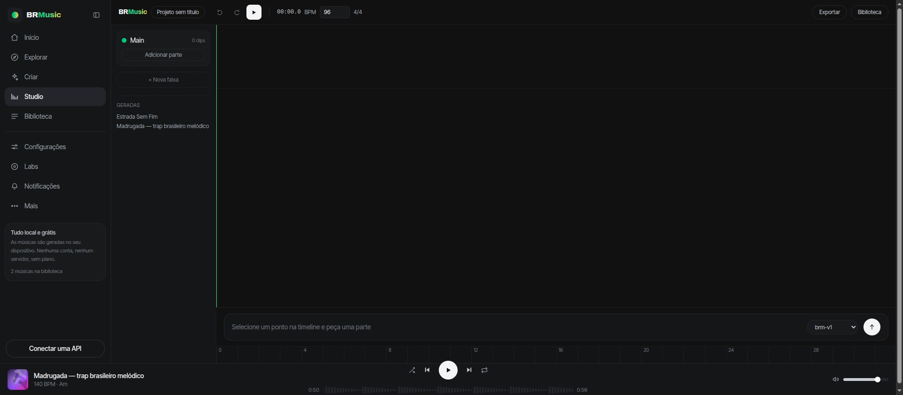
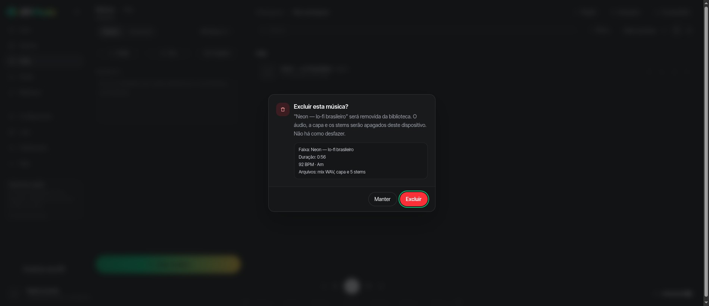
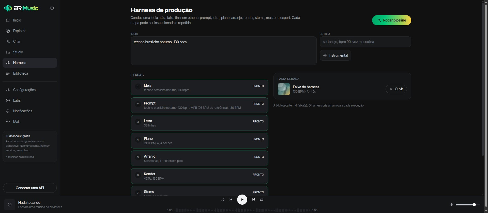

<p align="center">
  
</p>

<p align="center">
  <a href="https://github.com/andersonnarciso/brmusic/releases/tag/v1.0.3"></a>
  
  
</p>

# BR Music

**Languages: English (primary) | [Português (pt-BR)](README.pt-BR.md)**

A free, local-first, open source AI music generator. Create full songs (vocals, lyrics, production) from a short description, with a settings panel to connect your own LLM APIs and produce the audio.

> MIT licensed, no account, no plan, no server. Synthesis runs on your device.

---

## Screenshots

<p align="center">
  
</p>

| | |
|:--|:--|
|  |  |
| **Advanced creation**: lyrics with generator, styles, audio and creative controls | **Multitrack editor**: 5 stems, per channel mixer, trim, reverse, speed and remaster |
|  |  |
| **Creation**: Simple and Advanced modes, with the generated track in the list | **Library**: tracks, playlists, search, filters and trash |
|  |  |
| **Settings**: overview with KPIs and platform health | **AI providers**: OpenAI-compatible APIs and local runtimes |
|  |  |
| **Studio**: tracks, timeline, transport and prompt on the timeline | **Confirmation**: explicit warning about what will be deleted |
|  | |
| **Harness**: 9 stage pipeline, from prompt to mastered track | |

---

## What is in here

| Part | Where | What it does |
|---|---|---|
| Public site | `/` | Marketing landing: hero with the generator, feature cards, downloads and FAQ |
| Creator app | `#/create` | Music creation (3 columns), Songs and Speech tabs, Simple and Advanced modes, creative sliders, player |
| Library | `#/me` | Tracks, playlists, search, filters, sorting, list and grid views |
| Explore | `#/explore` | Discovery by style and occasion |
| Studio | `#/studio` | Simplified DAW: tracks, timeline, transport, prompt on the timeline |
| **Settings** | `#/admin` | AI providers, generation mode, app preferences, branding, integrations, diagnostics |
| Desktop app | `electron/` | Packaged for **Linux, Windows and macOS** |
| PWA | `public/sw.js` | Installable and usable offline in the browser |

### Languages

English is the primary language, Portuguese (pt-BR) is the secondary one. The whole interface switches at runtime, including the native menu of the desktop app on Linux, Windows and macOS.

The switcher lives in the **sidebar footer** (the `EN` / `PT` buttons) and in **More** (`#/more`). The choice is stored in `localStorage` and applies to every screen, including the settings panel.

### Advanced mode and professional editing

The creation panel has an **Advanced** mode with collapsible sections (Lyrics, Styles, Audio), an Automatic or Write lyrics toggle, a lyrics generator, an Instrumental switch, audio upload and microphone recording, plus the creative controls.

The **multitrack editor** (`#/editor/:id`) opens the track with the 5 stems separated and offers:

| Operation | What it does |
|---|---|
| Trim / Remove section | cuts or removes the region selected on the ruler |
| Reverse | inverts the channel audio |
| Speed | time stretch preserving pitch (WSOLA) |
| Fade in / Fade out | linear entry and exit ramps |
| Remaster | compressor plus air shelf plus soft clip, without clipping |
| Replace section | regenerates the selected region |
| Get stems | exports the 5 edited stems as a ZIP |
| Mixer | volume, pan, mute and solo per channel, master with volume, remaster and limiter |

### Production harness

The harness is the layer that drives generation **behind the Create button**. Nine stages: Idea, Prompt, Lyrics, Plan, Arrangement, Render, Stems, Mix and Master, Export.

Text stages use the LLM configured in the settings panel (with local generators as a fallback, so it works offline). After rendering, the harness applies the master, normalizes the peak to -1 dBFS and produces a **quality report** with loudness, peak, dynamics, stereo width and clipping. The `#/harness` page exists as an inspection view (reachable through the "ver detalhes da geração" link in the creation panel), but the normal flow is a single click.

For agents, the harness becomes a procedure: see [`skills/music-harness/SKILL.md`](skills/music-harness/SKILL.md) and the CLI:

```bash
node scripts/harness-cli.mjs "sertanejo brasileiro com sanfona" --style "118 bpm" --out ./faixas
```

The CLI opens the app in a headless Chrome controlled over a CDP pipe, triggers the creation, waits for the harness to finish and writes the mastered WAV plus a `relatorio.json` with the quality report.

### Automatically discovered music models

When you connect a provider, the **Load music models** button queries the provider and keeps **only the models able to generate music**, discarding text, vision and code models. For MiniMax, for example, `/v1/models` returns text models, so the app separates those from the music catalogue (`music-3.0`, `music-2.6`, `music-cover` and variants).

### Features that go beyond the usual

- **Exportable stems**: every track comes apart into drums, bass, pads, melody and vocals (ZIP), ready for your DAW.
- **Real waveform**: the player draws the actual peaks of the synthesized audio and accepts a click to seek.
- **Batch variations**: generate 4 versions of the same idea at once, with different seeds.
- **Remix and extend**: remix with another style or continue the track keeping tempo and key.
- **Playlists**: organize tracks locally.
- **Command palette**: `⌘K` / `Ctrl+K` with search and actions; shortcuts: `⌘N` (create), `Space` (play/pause).
- **Generated covers**: procedural album art in canvas, from the style palette and the track seed.
- **Connect any AI**: OpenAI-compatible, Anthropic, Gemini, OpenRouter, Groq and MiniMax presets, plus 10 local runtimes (Ollama, LM Studio, llama.cpp, vLLM, LocalAI, KoboldCpp, GPT4All, text-generation-webui, Jan, SGLang) with automatic port scanning. The audio provider can be the hosted MiniMax Music API, the self-hosted MiniMax Music 3 or your own endpoint.
- **Multitrack editor** with per channel mixer, trim, reverse, pitch preserving speed, fades, remaster and export of the edited stems.
- **FTP hosting**: send generated music straight to your traditional hosting account (cPanel, Hostinger, Locaweb), with connection test and optional automatic upload.
- **Trash**: reversible deletion, with restore or permanent delete (always with confirmation).

**No track is pre-recorded.** The engine (`src/lib/audio/engine.ts`) synthesizes the music in the browser with Web Audio: drums, bass, pad, chords, lead, a formant based vocal layer, reverb and mastering, in 44.1 kHz stereo WAV, with separated channels per stem.

---

## Running it

```bash
cd brmusic
npm install

npm run dev        # dev server (http://127.0.0.1:4329)
npm run build      # production build into dist/
npm run server     # server with the settings API and the static build
npm run typecheck  # type checking
node scripts/check-i18n.mjs   # checks that every interface string has a translation
```

`npm run server` listens on `http://127.0.0.1:4328` and serves `dist/` (run `npm run build` first). Useful environment variables:

```bash
PORT=4328
BRMUSIC_ADMIN_TOKEN=your-token     # requires the x-admin-token header on /api/admin/*
BRMUSIC_DATA_DIR=/path/to/data     # where config.json is written
```

### Desktop app (Electron)

```bash
npm install --save-dev electron electron-builder
npm run build                 # frontend build
npm run desktop:dir           # unpacked build, for testing
npm run desktop               # installers (AppImage/deb, nsis, dmg)
```

The installers for the three systems are produced by GitHub Actions (`.github/workflows/release.yml`): a `v*` tag triggers builds on Linux, Windows and macOS and publishes the release with the files attached.

In the desktop app, `window.desktop` exposes save dialogs and direct disk writes: the mix and the stems ZIP are written where you choose, instead of being downloaded.

### PWA

`npm run build` produces an installable app (manifest plus service worker): offline, with no app store.

---

## Connecting your AI APIs (settings panel)

Open `#/admin` and go to **AI providers**. Each provider has: compatibility preset, base URL, endpoint, model, **API key**, temperature, max tokens, timeout, JSON mode, enable/disable and a **Test connection** button.

Keys are written **on the server only** (`server/data/config.json`) and never come back to the browser, the panel shows only the mask. With no server running, everything is stored in this browser `localStorage`.

### Available presets

| Preset | Base URL | Format |
|---|---|---|
| MiniMax | `https://api.minimax.io/v1` | OpenAI-compatible (`/chat/completions`, `Bearer`), extremely low cost per token |
| OpenAI | `https://api.openai.com/v1` | OpenAI-compatible |
| Custom (OpenAI-compatible) | any URL | any `/chat/completions` (Together, Groq, vLLM, LM Studio, OpenRouter…) |
| Anthropic | `https://api.anthropic.com/v1` | `/messages` with `x-api-key` |
| Google Gemini | `https://generativelanguage.googleapis.com/v1beta` | `/models/{model}:generateContent` |
| OpenRouter | `https://openrouter.ai/api/v1` | OpenAI-compatible |
| Groq | `https://api.groq.com/openai/v1` | OpenAI-compatible |

The model field is free form: just type the identifier. For MiniMax the models in production are `MiniMax-M3.1-Flash`, `MiniMax-M3`, `MiniMax-M2.1` and `MiniMax-M2`, and the cost per token is extremely low, which makes it a good choice for frequent use inside the app.

### Local LLM runtimes (all supported)

BR Music talks to **any** OpenAI-compatible server running on your machine, with no API key. There is a preset for each one and an **automatic scan** that finds what is already up:

| Runtime | Default port | Note |
|---|---|---|
| Ollama | 11434 | dedicated preset (`/api/chat`); also serves `/v1` |
| LM Studio | 1234 | OpenAI-compatible |
| llama.cpp (`llama-server`) | 8080 | OpenAI-compatible |
| vLLM | 8000 | OpenAI-compatible |
| LocalAI | 8080 | Ollama plus GPT4All plus llama.cpp |
| KoboldCpp | 5001 | with the `--api` flag |
| GPT4All | 4891 | built-in server |
| text-generation-webui | 5000 | with the `--api` flag |
| Jan | 1337 | Jan local server |
| SGLang / local MiniMax M2 | 30000 | OpenAI format |

The **Load local runtimes** button scans those nine ports, shows which answered and with which models, and registers the provider ready to use. The same applies to any server outside the list: use the "Custom (OpenAI-compatible)" preset with the base URL and endpoint.

### Three music generation modes

In `#/admin` go to **Music generation**:

1. **Local engine (procedural)**: the default. No server, no cost, works offline.
2. **Plan via LLM**: the enabled LLM writes the musical *plan* (title, lyrics with `[Verse]/[Chorus]`, BPM, key, progression, sections with energy) as JSON; the local engine performs that arrangement.
3. **External audio**: an HTTP provider generates the final audio. Pick the provider in **Audio provider**:
   - **MiniMax Music (hosted, legacy)**: `POST https://api.minimax.io/v1/music_generation`, body with `model` (`music-3.0`, `music-2.6`, `music-cover`…), `prompt`, `lyrics`, `output_format` (`hex`/`url`), `audio_setting` (`sample_rate`, `bitrate`, `format`), `lyrics_optimizer`, `is_instrumental`; the response carries `data.audio` in hexadecimal plus `base_resp.status_code` (1002 = rate limit, 1004 = authentication, 1008 = balance, 1026 = blocked content).
   - **MiniMax Music 3 (self-hosted)**: `POST http://127.0.0.1:8000/v1/audio/speech`, body with `model` (`MiniMaxAI/MiniMax-Music3`), `input` (the lyrics), `instructions` (the style), `seed`, `max_new_tokens` and `response_format: "wav"`; the response is a WAV file. This is the [open source MiniMax Music 3](https://huggingface.co/MiniMaxAI/MiniMax-Music3) served by SGLang-Omni on an NVIDIA GPU. Output is capped at roughly 30 seconds.
   - **Your own endpoint**: any HTTP service that answers with audio bytes (WAV/MP3) or JSON with the audio in base64.

The **Test** button runs a short real generation to validate the key and the endpoint.

The creator app uses the configured mode automatically. When the external provider fails, the app **falls back to the local engine** and tells you why, so a track is never lost to a provider error.

### Status of the hosted MiniMax Music API

> **The hosted MiniMax Music API was discontinued for new accounts on 20/08/2026.**
> A request from a new account answers `HTTP 410` with `base_resp.status_code: 2153` ("This Music API is no longer available to new users").

Existing paying accounts keep working. For a new account, use one of these instead:

| Option | What you need |
|---|---|
| **Local engine** (default) | nothing, it ships with the app and always works offline |
| **MiniMax Music 3 self-hosted** | a machine with an NVIDIA GPU running [MiniMax Music 3](https://huggingface.co/MiniMaxAI/MiniMax-Music3) over SGLang-Omni, reachable over HTTP |
| **MiniMax Audio** | a MiniMax account with the Audio product enabled (the successor endpoint of the Music API) |
| **Your own endpoint** | any HTTP service that returns audio |

When the hosted API answers 410, the app disables that provider on its own and explains why, instead of retrying a dead endpoint on every track.

---

## Server API

| Route | Method | Description |
|---|---|---|
| `/api/health` | GET | generation mode, provider and enabled LLMs |
| `/api/generate` | POST | `{prompt, lyrics, instrumental, style}` returns the musical *plan* (`{source: "local" \| "llm-plan", …}`) |
| `/api/generate/audio` | POST | `{prompt, lyrics, instrumental}` returns the final audio from the external provider as `{source, audioBase64, audioFormat, durationSec}`. When no external provider is enabled it answers `{source: "local", audioBase64: null}` and the local engine takes over |
| `/api/admin/config` | GET / PUT | full configuration (secrets masked on read) |
| `/api/admin/provider/test` | POST | tests an LLM provider (`{providerId}`) |
| `/api/admin/provider/discover-models` | POST | lists the provider models and keeps only the music capable ones |
| `/api/admin/music/test` | POST | generates a real track on the audio provider |
| `/api/admin/music/presets` | GET | the audio provider presets (base URL, endpoint and models) |
| `/api/admin/ftp/test` | POST | tests the connection with the FTP host |
| `/api/ftp/upload` | POST | uploads a file (base64) to the FTP host |
| `/api/lyrics` | POST | writes the lyrics with the enabled LLM |
| `/api/admin/stats` | GET | platform KPIs |
| `/api/admin/activity` | GET | recorded events (through `config.activity`) |

---

## Contributing

**Contributions are welcome.** The project is free (MIT) and was built to be extended.

Good starting points:

- **New audio engines**: `src/lib/audio/engine.ts` synthesizes the tracks, `src/lib/audio/edit.ts` handles trim, reverse, speed, fades and remaster. Operations are non destructive.
- **New styles and presets**: `src/lib/audio/presets.ts` maps keywords (in Portuguese and English) to tempo, scale, progression and timbre.
- **New AI providers**: `server/models.mjs` classifies models by music capability; `src/lib/adminTypes.ts` holds the compatibility preset catalogue.
- **Harness tweaks**: `src/lib/harness.ts` defines the staged pipeline and the quality report.
- **New platform ports**: `electron-builder.yml` and `.github/workflows/release.yml` produce the installers.

How to run it for contribution:

```bash
npm install
npm run dev        # app on http://127.0.0.1:4329
npm run server     # settings API on another port
npm run typecheck
npm run verify:desktop
```

Open an issue describing the idea before touching large amounts of code, so we can align on the path.

---

## Structure

```
brmusic/
├── src/
│   ├── lib/
│   │   ├── audio/{engine,theory,presets}.ts   # synthesis, scales, styles
│   │   ├── audio/{edit,analyze}.ts             # trim, reverse, speed, fades, remaster, BPM detection
│   │   ├── harness.ts                           # production pipeline and quality report
│   │   ├── store.ts                             # state, player and persistence
│   │   ├── persist.ts                           # localStorage plus IndexedDB
│   │   ├── export.ts                            # WAV/ZIP, download or desktop write
│   │   ├── adminClient.ts                       # settings API client
│   │   └── adminTypes.ts                        # configuration types
│   ├── components/                              # Sidebar, PlayBar, CreatePanel, SongList, Waveform, CommandPalette, Slider, Icons
│   ├── pages/                                   # Landing, Home, Library, Explore, Studio, Harness, Simple
│   ├── admin/                                   # AdminApp, Providers, Manage, ui
│   └── App.tsx                                  # hash router and shortcuts
├── electron/                                    # desktop app (main, preload)
├── server/                                      # settings API, proxy, static files, FTP
├── skills/music-harness/                        # agent skill for the harness
├── scripts/                                     # desktop build, icons, harness CLI
├── public/                                      # PWA manifest, service worker, icons
└── docs/                                        # screenshots
```

### Technical decisions

- **Hash routing** (`#/create`) so it works on any static host without rewrite rules.
- **Two independent stores** (`appStore` and `playerStore`): the player updates 4×/s without re-rendering the whole tree.
- **Metadata in localStorage, blobs in IndexedDB**: audio does not hit the 5 MB quota and survives a reload (blob URLs are recreated on boot).
- **Assets imported through the bundler**: logo and media URLs are hashed and relative, so they work over http, under a subpath and under `file://` in the desktop app.
- **Tailwind v4** with theme tokens in `src/styles.css`; build is about 27 KB of CSS and 80 KB of JS (gzip).

---

## Known limits

- Audio, voice and image upload (file based remix), hooks, albums and "Cover Art" are screens or tabs without a matching backend. Stems, playlists, variations, remix and extend **work**.
- The "voice" of the procedural engine is a synthetic formant layer, not really sung vocals.
- With no server running, the settings panel persists to `localStorage` and the API connection test cannot reach the real provider.
- The Windows and macOS installers are compiled in CI (macOS needs a macOS runner); locally only Linux can be packaged.
- Synthesis is procedural: there is no trained audio model behind it. Nothing is pre-recorded.
